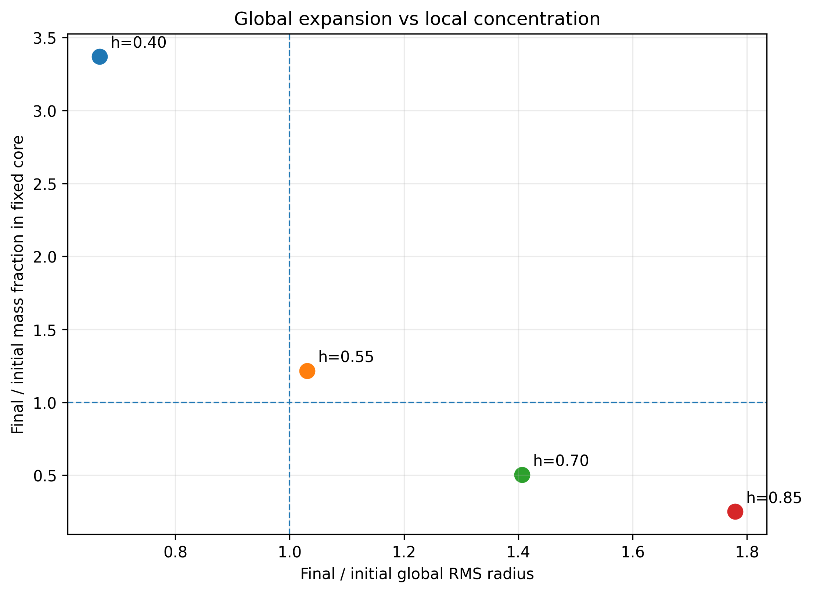

# Classical and Quantum-Wave Dynamics of Self-Gravitating Systems

**A Three-Dimensional Computational Investigation of Newtonian Gravity, Schrödinger–Poisson Dynamics, Entropy, and Structural Evolution**

**Author: Kanak**

Python · Google Colab · Computational Physics · Gravitational Dynamics

---

## 1. Overview

How does a self-gravitating system evolve when gravitational attraction competes with quantum-wave dispersion?

This project investigates that question using classical Newtonian particle simulations and three-dimensional Schrödinger–Poisson wave dynamics.

It combines numerical modelling, gravitational thermodynamics, spatial entropy analysis, classical–wave comparisons, and numerical validation.

**The principal investigation examines whether a self-gravitating wave cloud can expand globally while simultaneously increasing the fraction of mass concentrated within a fixed central region.**

The simulations use dimensionless parameters and are intended as a computational investigation, not an observational model of a particular astronomical system.

## 2. Research Questions

The study addresses four connected questions:

1. How do gravitational attraction and wave dispersion influence contraction and expansion?
2. Can increasing central mass concentration coexist with overall cloud expansion?
3. How do classical particle models and self-gravitating wave models differ under controlled initial conditions?
4. How reliably can these behaviours be resolved using finite numerical grids and time integration?

## 3. Computational Framework

| Component | Method |
|---|---|
| Newtonian particle dynamics | Softened N-body gravity |
| Particle time integration | Velocity-Verlet |
| Stellar-cluster modelling | Plummer distribution |
| Wave dynamics | 3D Schrödinger–Poisson equations |
| Gravitational potential | Fourier spectral Poisson solver |
| Wave time integration | Symmetric Strang splitting |
| Classical–wave comparison | Energy-matched particle-mesh control |
| Statistical diagnostics | Coarse-grained spatial Shannon entropy |
| Numerical validation | Conservation, analytical benchmarks, convergence and box-size tests |

The initial planar N-body experiment uses the softened three-dimensional Newtonian inverse-square force law with particles restricted to a plane. It is not a fundamental two-dimensional gravitational field model.

The wave calculations use periodic boundary conditions and subtract the mean density in the Fourier Poisson solution.

## 4. Principal Numerical Findings

### 4.1 Competition Between Gravity and Wave Dispersion

For the initially Gaussian wave cloud, at dimensionless time \(t=3\):

| Effective ℏ | Final / Initial RMS Radius | Observed Behaviour |
|---|---:|---|
| 0.40 | 0.6673 | Net contraction |
| 0.55 | 1.0308 | Slight net expansion |
| 0.70 | 1.4064 | Expansion |
| 0.85 | 1.7789 | Stronger expansion |

Under the selected initial conditions, smaller effective wave-dispersion parameters produce greater contraction, while larger values produce greater expansion.

The effective ℏ is a dimensionless numerical parameter. The physical Planck constant is not being varied.

### 4.2 Global Expansion with Increasing Central Concentration

At effective ℏ = 0.55 and dimensionless time \(t=3\), the wave simulation produces:

| Diagnostic | Final / Initial Ratio | Relative Change |
|---|---:|---:|
| Global RMS radius | 1.030831 | +3.08% |
| Central mass fraction | 1.215669 | +21.57% |
| Peak density | 1.384875 | +38.49% |

The central region is defined as the fixed spherical volume whose radius equals the initial Gaussian width.

**The important result is that the cloud's RMS radius increases while the fraction of its total mass inside this central region also increases.**

This does not violate mass conservation: the simulation tracks redistribution of existing mass.

The result illustrates why global size alone is insufficient to characterize a self-gravitating system's internal evolution.

### 4.3 Finite-Time Structural Crossover

An additional parameter sweep examines effective ℏ values from 0.52 to 0.60.

| Effective ℏ | Radius Ratio | Central Mass Fraction Ratio |
|---|---:|---:|
| 0.52 | 0.9559 | 1.4880 |
| 0.54 | 1.0058 | 1.2993 |
| 0.55 | 1.0308 | 1.2157 |
| 0.56 | 1.0559 | 1.1385 |
| 0.58 | 1.1060 | 1.0014 |
| 0.60 | 1.1561 | 0.8844 |

The intermediate range demonstrates simultaneous global expansion and central mass-fraction growth under the selected model conditions.

This is a finite-time structural crossover, not evidence of a thermodynamic phase transition.

## 5. Numerical Validation

Numerical checks are included to evaluate solver accuracy and sensitivity to computational parameters.

The independent periodic-wave audit reports six successful checks under its defined thresholds.

| Validation Test | Recorded Result |
|---|---|
| Poisson solver residual | 5.85 × 10⁻¹⁴ |
| Time-reversal error | 9.01 × 10⁻¹⁵ |
| Maximum mass conservation error | 2.23 × 10⁻¹¹% |
| Maximum energy conservation error | 0.01011% |
| Free Gaussian benchmark error | 0.08280% |
| Time-step convergence order | Approximately 2.0 |

These results support the numerical implementation within the tested configurations. They do not establish that all physical or discretization errors are negligible.

### Spatial Grid Validation

At effective ℏ = 0.55:

| Grid Resolution | RMS Radius Ratio | Central Mass Fraction Ratio |
|---|---:|---:|
| 32³ | 1.030834 | 1.239620 |
| 48³ | 1.030831 | 1.215669 |
| 64³ | 1.030830 | 1.217586 |

The central mass-fraction ratio differs by approximately **0.1575%** between the two finer grids.

The simultaneous expansion/concentration behaviour persists across the tested resolutions. The fixed-radius core diagnostic remains sensitive to grid discretization, especially at coarse resolution.

## 6. Classical Gravitational Dynamics

The classical component includes:

- Softened Newtonian N-body simulations.
- Plummer stellar-cluster evolution.
- Velocity perturbations and dynamical readjustment.
- Virial and gravitational-energy diagnostics.
- Spatial and kinetic-distribution analysis.
- Energy-matched classical particle-mesh comparisons.

The Plummer experiments investigate transient structural and kinetic responses.

Exploratory negative energy–temperature slopes are treated as non-equilibrium diagnostics, not as direct proof of equilibrium negative heat capacity.

## 7. Entropy and Statistical Analysis

Coarse-grained spatial Shannon entropy is used to examine changes in the distribution of matter.

The project studies how spatial concentration and dispersion affect this statistic.

Spatial Shannon entropy is not equivalent to total thermodynamic entropy. Its interpretation depends on the coarse-graining procedure and chosen model.

## 8. Reproducibility

The complete simulation source is supplied as a Jupyter notebook.

**Requirements**

Python 3, NumPy, SciPy, Pandas and Matplotlib. Google Colab is the intended execution environment.

**Instructions**

1. Open the notebook in Google Colab.
2. Start with a clean runtime.
3. Execute all notebook cells sequentially.
4. Review the conservation, convergence and numerical-validation outputs.
5. Run the final export cell to generate the datasets, figures, documentation and ZIP archive.

The notebook itself is distributed separately from the exported ZIP.

The complete run includes computationally intensive three-dimensional simulations.

## 9. Repository Structure

- **Jupyter notebook (`.ipynb`)** — Full simulation code and executed results.
- **`datasets/`** — 13 numerical CSV datasets.
- **`figures/`** — 12 PNG figures and their 12 PDF versions.
- **`additional_validation/`** — Supplementary numerical audit and finite-box testing.
- **`documentation/`** — Scientific checks, results and model limitations.
- **`README.md`** — Research overview and reproducibility guidance.

## 10. Scientific Scope and Limitations

The simulations must be interpreted within the following boundaries:

- The model uses Newtonian gravity and dimensionless parameters.
- The Schrödinger–Poisson system describes self-gravitating wave dynamics, not quantum gravity.
- The simulations do not incorporate cosmological expansion or general relativity.
- The wave model uses periodic gravitational boundary conditions.
- The findings depend on initial conditions, simulation duration, grid resolution and finite-box effects.
- The fixed central region is a diagnostic definition, not proof of a stable solitonic core.
- Classical particle-mesh comparisons remain more sensitive to numerical resolution than the principal wave-radius calculation.
- The preliminary classical particle-mesh experiment reports energy drift up to approximately 0.342%; the energy-matched control reports a maximum of approximately 0.034%.
- Numerical validation does not establish universal physical behaviour.
- The study does not establish an experimentally verified astrophysical phenomenon or a new physical law.

## 11. Research Context and References

This project is related to established research in stellar dynamics and self-gravitating wave systems.

1. H. C. Plummer (1911), *On the Problem of Distribution in Globular Star Clusters*, Monthly Notices of the Royal Astronomical Society, 71, 460–470.  
   https://doi.org/10.1093/mnras/71.5.460

2. H.-Y. Schive, T. Chiueh and T. Broadhurst (2014), *Cosmic Structure as the Quantum Interference of a Coherent Dark Wave*, Nature Physics, 10, 496–499.  
   https://doi.org/10.1038/nphys2996

3. H.-Y. Schive et al. (2014), *Understanding the Core-Halo Relation of Quantum Wave Dark Matter from 3D Simulations*, Physical Review Letters, 113, 261302.  
   https://doi.org/10.1103/PhysRevLett.113.261302

These works provide scientific context. The present simulation is not a reproduction of their full cosmological models.

## 12. Conclusion

This project investigates the competition between gravitational attraction and wave dispersion through classical particle dynamics and three-dimensional self-gravitating wave simulations.

The central numerical result is the coexistence of **global expansion and increasing central mass concentration** for an intermediate effective wave parameter.

Combined with classical comparisons, entropy diagnostics and numerical validation, the study demonstrates the importance of analyzing multiple structural observables when studying gravitational evolution.

The conclusions are limited to the numerical models and conditions documented in the repository.

---

**Author: Kanak**

*November 2026 · Computational Physics · Astrophysics · Gravitational Dynamics*
