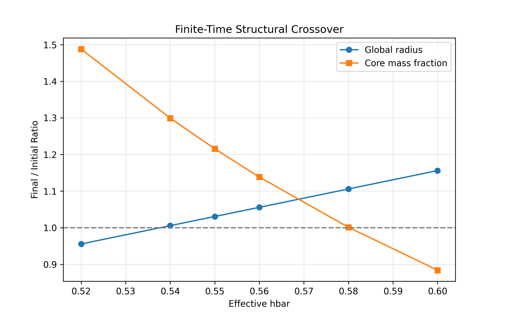
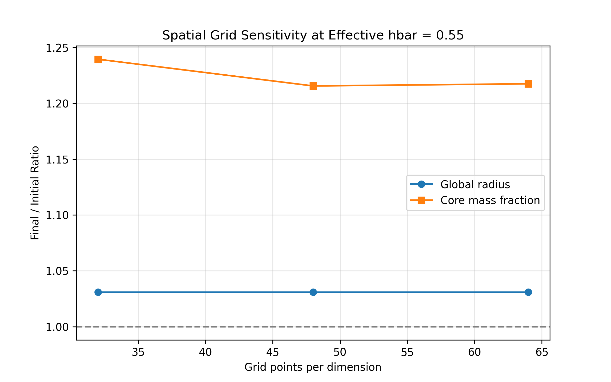

# Classical and Quantum-Wave Dynamics of Self-Gravitating Systems

**Author: Kanak** | Python / Google Colab | Dimensionless computational study

## Research question
Can a self-gravitating wave cloud grow in overall size while its mass becomes
more centrally concentrated over a fixed simulation interval? How does this
compare with classical particle dynamics and coarse-grained spatial entropy?

## Main finite-time result
At **effective ℏ = 0.55**, dimensionless **t = 3**, and with an
initially Gaussian cloud in a periodic Newtonian Schrödinger–Poisson model:

| Measured diagnostic | Final / initial value |
|---|---:|
| Global RMS radius | **1.030831** |
| Mass fraction within the fixed initial Gaussian width | **1.215669** |
| Maximum density | **1.384875** |

A larger global RMS radius together with a larger *fraction* of mass in the
fixed central volume is observed for these tested conditions. The inner
fraction is **not** a new mass source: the total mass is conserved and mass
is redistributed. The result is not proof of a bound soliton or a new
astrophysical phenomenon.

## Parameter study
The closer parameter sweep **0.52–0.60** finds an intermediate range in which
both measures increase. This is a **finite-time crossover** under a specified
model, **not** a thermodynamic or quantum-gravity phase transition.

## Grid check
At ℏ = 0.55 the fixed-core ratio is compared on 32³, 48³, and 64³ grids.
The relative difference between the two finer grids is **0.1575%**;
this checks sensitivity to these three spatial discretizations, not the
complete continuum limit. The sharp core-radius cutoff introduces some
resolution dependence of its own.

## Methods and controls
- Softened Newtonian N-body dynamics and velocity-Verlet integration;
  the early *planar* particles interact via a 3D inverse-square force law,
  **not** the fundamental 2D gravitational Poisson problem.
- 3D Plummer-cluster response to initial-velocity perturbations.
- A classical 3D cloud-in-cell particle-mesh model and an energy-matched
  comparison to a Gaussian Schrödinger–Poisson wave field. Energy matching
  does **not** make the classical and wave models identical.
- FFT solution of the periodic Poisson equation with mean-density subtraction
  and a second-order Strang splitting algorithm for wave dynamics.
- Coarse-grained spatial Shannon entropy as a distributional diagnostic.
- Poisson residual, time-reversal, free Gaussian benchmark, mass/energy
  conservation, time-step, grid, and finite-box checks.

## Recorded checks and limitations
The auxiliary periodic-wave audit reports **6/6**
checks passing under its documented thresholds. The energy-matched classical
particle-mesh experiments have a worst reported relative energy deviation of
approximately **0.0340%**; that is less accurate than the wave
runs and should not be concealed. No test rules out every modelling or
numerical uncertainty.

- All parameters are **dimensionless**; no astronomical measurement or
  observation is being fitted.
- The Schrödinger–Poisson model uses Newtonian gravity; it does **not**
  simulate quantum gravity.
- Its potential is periodic, and edge effects, grid spacing, sharp core
  mask, finite run time, and selected initial conditions limit conclusions.
- Spatial Shannon entropy is **not** a measurement of total thermodynamic
  entropy.
- Plummer kinetic-temperature curves and finite-time energy–temperature
  fits are **non-equilibrium diagnostics**, not confirmed negative heat
  capacity of an equilibrium cluster.
- A constructed virial-scaling family is a mathematical illustration, not
  an independent discovery or experiment.
- No claim of scientific novelty, universal stability, or experimental
  detection is made.

## Reproducibility
1. Open the accompanying `.ipynb` in Google Colab (Python 3).
2. Select **Runtime → Disconnect and delete runtime** before a clean rerun.
3. Run all cells sequentially with NumPy, SciPy, Pandas, Matplotlib.
4. The *last* code cell writes the authoritative README, CSV datasets,
   figures, numerical audit summaries, and final results ZIP.
5. Include the source `.ipynb` separately when sharing the exported ZIP.

## Repository layout
- `*.ipynb` — complete, executable simulation source
- `datasets/` — numerical CSV exports
- `figures/` — saved PNG and PDF visualizations
- `additional_validation/` — independent box/timestep reports
- `documentation/` — scientific audit and limitations

**For all figures, compare the stated parameters, time interval, and
boundary conditions before drawing a physical conclusion.**
